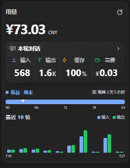

# 用量卡片 / Usage card

DeepSeek Harness 侧栏头像上方的用量卡片。



## 功能

- 账户余额
- 本轮对话：输入、输出、缓存命中、花费；点击可切换到今日汇总
- 24 小时高峰 / 低谷时间轴
- 最近 10 轮输入 / 输出用量
- 跟随 DSH 语言切换，支持全部 8 种语言

## 安装

```bash
git clone https://github.com/cosmoyu/dshcost-skill.git dshcost-skill
```

在 DSH 中执行：

```text
plugin_manager install_bundle <dshcost-skill 的绝对路径>
```

安装后刷新页面。

插件依赖 `zod`；如果 profile 安装时未自动安装依赖，可在插件目录执行 `npm install`。读取 `.zstd` 会话日志需要 Node 22.15+。

## 说明

- 用量来自本机会话日志，不会上传会话内容。
- 花费为估算值，实际扣费以 DeepSeek 账单为准。

## 许可

[MIT](LICENSE)
